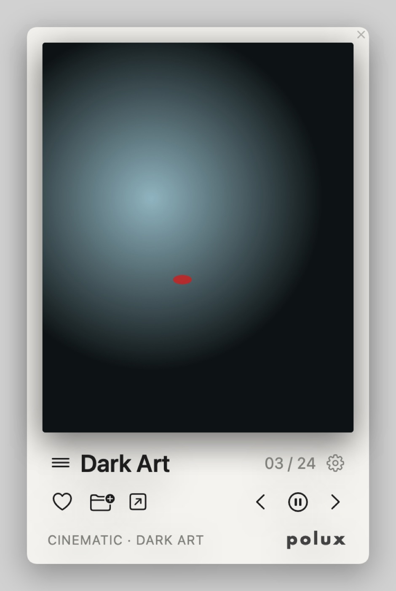
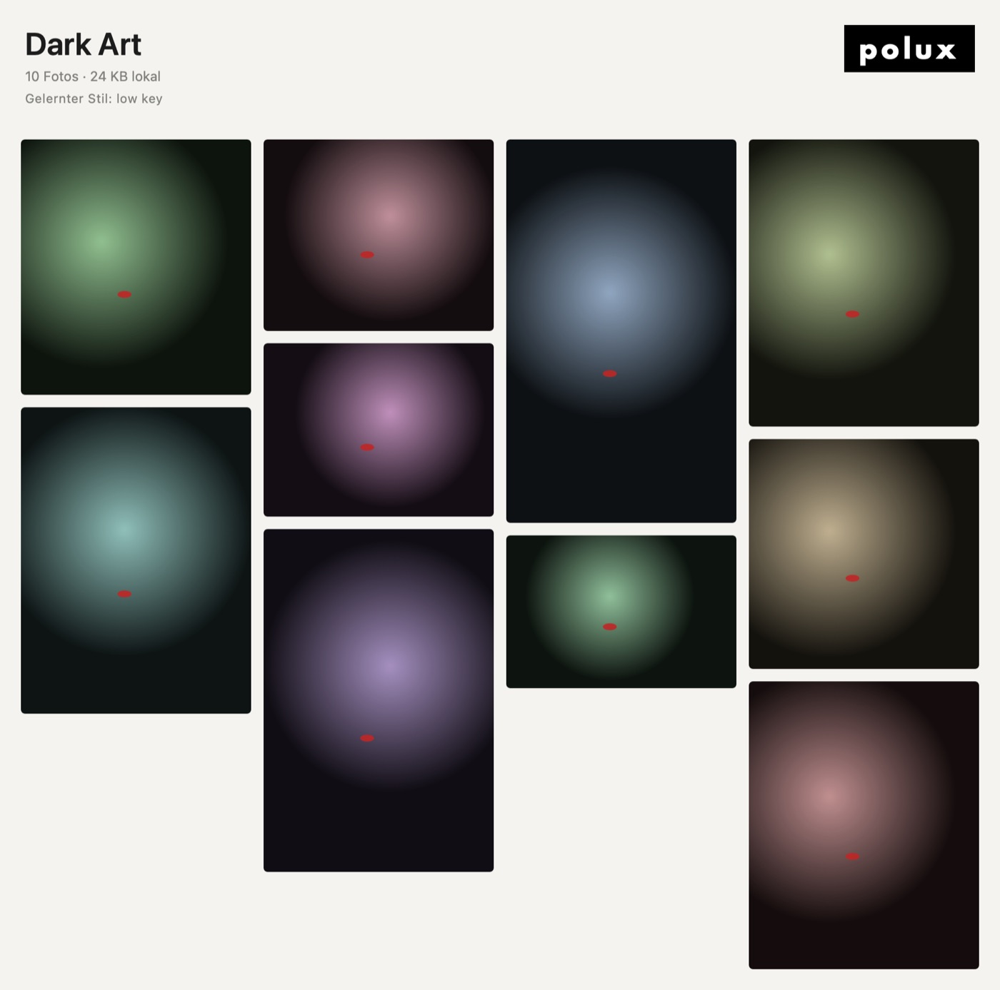

# Polux

Ein Polaroid-Widget für den Mac, das dich mit Bildideen versorgt. Alle paar Minuten erscheint im Polaroid ein neues Foto aus dem Netz, passend zur gewählten Sammlung. Fotos, die du likest, speichert Polux platzsparend. Aus ihnen lernt die App deinen Bildstil.

## Funktionen

| Bereich | Was Polux macht |
|---|---|
| **Polaroid-Widget** | Rahmenlos und frei verschiebbar (am Bild ziehen). Die Position bleibt gespeichert. Ebene wählbar: Schreibtisch (Widget), Normal oder Immer oben. Drei Größen. |
| **Bildwechsel** | Standardmäßig alle 5 Minuten (einstellbar). Pause/Play, Zurück, Weiter. Die Zählung `03 / 24` zeigt die Position im Verlauf der letzten 24 Fotos. |
| **Herz** | Speichert das Foto in der aktuellen Sammlung. Polux merkt sich Tags, Motiv, Helligkeit und den visuellen Fingerabdruck und sucht danach gezielt im gleichen Stil weiter. |
| **Ordner +** | Übernimmt das Foto in eine andere Sammlung. |
| **Link-Symbol** | Öffnet die Originalseite des Fotos (Linkansicht). |
| **Burger-Menü** | Öffnet den Reiter mit den Sammlungen: wechseln, per Drag & Drop sortieren, unten neue anlegen. Rechtsklick öffnet Galerie, Bearbeiten und Löschen. |
| **Zahnrad** | Einstellungen: Sammlungen, Schlagwörter, Ausschlusswörter, Akt/Mature erlauben, Regler für „Düstere Inszenierung“, Quellen, API-Schlüssel, Autostart, Speicher, Updates. |
| **Doppelklick aufs Foto** | Öffnet die Mosaik-Galerie der Sammlung, oben rechts mit dem `polux`-Schriftzug (weiß auf schwarz). Fotos lassen sich dort ansehen, verlinken und entfernen. |
| **Entfernen in der Galerie** | Das Stilprofil wird neu berechnet und der Stil des entfernten Fotos als Negativ-Signal gewertet. Bereits vorgemerkte Vorschläge verwirft Polux und sucht neu. |
| **Hintergrundbetrieb** | Kein Dock-Symbol, dafür ein Kamera-Symbol in der Menüleiste. Polux startet beim Anmelden automatisch (abschaltbar). |
| **Updates** | Prüft einmal täglich die GitHub-Releases. Die Prüfung lässt sich auch in den Einstellungen anstoßen. |

### Wie lernt Polux deinen Stil?

Alles läuft auf dem Mac (Apple Vision), es werden keine Bilder an Dritte geschickt.

1. **Begriffe**: Tags der Quellen und erkannte Motive aus deinen Likes werden gewichtet. Häufige Stilbegriffe ergänzen automatisch deine Suchanfragen (z. B. `low key portrait` + `veil`).
2. **Visuelle Ähnlichkeit**: Für jedes Foto berechnet Polux einen Bild-Fingerabdruck (Feature Print). Neue Kandidaten, die deinen Likes ähneln, werden bevorzugt.
3. **Helligkeit**: Der Regler „Düstere Inszenierung“ und die mittlere Helligkeit deiner Likes ziehen Low-Key-Bilder nach vorn.
4. **Negativ-Signale**: Fotos, die du aus der Galerie entfernst, drücken ähnliche Vorschläge nach hinten.
5. **Zufall**: Ein kleiner Zufallsanteil sorgt dafür, dass Polux sich nicht in einem Stil festfährt.

### Speicherbedarf

Ein Like wird als kompaktes HEIC-Vorschaubild gespeichert, standardmäßig 900 px, ca. 60–100 KB. Dazu kommen Link und Metadaten. Die Originalgröße lädt Polux nur bei Bedarf aus dem Netz. Der Verlaufs-Cache hält höchstens 24 Fotos. In den Einstellungen unter „Allgemein“ siehst du den Verbrauch und kannst die Speichergröße anpassen.

## Bildquellen

| Quelle | Zugang | Hinweis |
|---|---|---|
| Openverse | ohne Schlüssel | Bündelt Flickr (Creative Commons), Wikimedia Commons, Museen u. a. Mature-Inhalte sind zuschaltbar. |
| Pinterest | RSS pro Board | Pinterest bietet keine öffentliche Such-API. Öffentliche Boards trägst du pro Sammlung ein (`https://www.pinterest.com/nutzer/board/`). |
| ArtStation | ohne Schlüssel | Inoffizielle Schnittstelle, kann zeitweise ausfallen. |
| Unsplash | kostenloser Access Key | Akt wird von Unsplash weitgehend ausgefiltert. |
| Flickr | kostenloser API Key | Eingeschränkte Inhalte liefert Flickr ohne Benutzer-Login nur begrenzt. |
| Pexels | kostenloser API Key | Keine Akt-Inhalte. |
| DeviantArt | Client ID + Secret | Suche über Tags. |
| Behance | – | Keine öffentliche API mehr verfügbar. |

API-Schlüssel landen im macOS-Schlüsselbund.

## Installation

1. Unter **Releases** (oder unter **Actions → Artefakte**) die Datei `Polux-x.y.z.zip` laden und entpacken.
2. `Polux.app` in den Ordner **Programme** ziehen.
3. Beim ersten Start **Rechtsklick → Öffnen** wählen. Die App ist nicht von Apple notarisiert, deshalb fragt Gatekeeper einmal nach.

Voraussetzung ist macOS 13 (Ventura) oder neuer, auf Apple Silicon oder Intel.

## Selbst bauen

```bash
./scripts/build-app.sh          # erzeugt dist/Polux.app und dist/Polux-<version>.zip
open dist/Polux.app
```

Dafür brauchst du Xcode bzw. die Command Line Tools (Swift 5.9+).

**Neue Version veröffentlichen:** `VERSION` anpassen, committen und einen Tag `vX.Y.Z` pushen. Die GitHub Action baut die App und legt ein Release an. Die Update-Prüfung in der App findet es danach automatisch.

## Projektstruktur

```
Sources/Polux/
  App/        Start, Fenster (Polaroid, Galerie, Einstellungen), Menüleiste, Vorschau-Renderer
  Engine/     InspirationEngine (Rotation, Verlauf, Likes) · StyleEngine (Stil-Lernen, Bewertung)
  Providers/  Openverse, Unsplash, Flickr, Pexels, DeviantArt, ArtStation, RSS/Pinterest
  Storage/    Sammlungen (JSON), Bild-Kodierung (HEIC), Schlüsselbund, Einstellungen
  Services/   Autostart, Update-Prüfung
  Views/      Polaroid, Sammlungs-Reiter, Mosaik-Galerie, Einstellungen
```

Daten liegen unter `~/Library/Application Support/Polux/`, der Cache unter `~/Library/Caches/Polux/`.

## Vorschau

Wird bei jedem Build automatisch auf einem Mac gerendert (mit Platzhalterbildern):

| Polaroid | Galerie |
|---|---|
|  |  |
